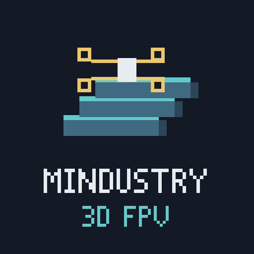

# Mindustry³ — 3D & FPV for Mindustry

(!Before you'll read the repository i want to notice you that the entire project is 99% vibe-coded!)

Mindustry³ started with a simple idea: what if I could fly a unit in Mindustry from a first-person perspective, with controls inspired by Liftoff?

What began as an FPV flight experiment gradually became a much larger project: a three-dimensional Mindustry experience with XYZ movement, multi-floor factories, volumetric construction, procedural landscapes and modeled industrial machinery.

**Current candidate:** Alpha 2.0.0 RC1 · **Mod version:** 0.19.0 · **Target game:** Mindustry 160.7.

RC1 is prepared locally and has **not been publicly released**. This is my experimental, fan-made mod, not an official Mindustry release.

## What is Mindustry³?

I'm developing Mindustry³ to explore familiar factories, units and battles from a different perspective. You can fly in first person, switch to a third-person camera, or return to the original 2D view. Build Mode brings construction into the same 3D world, including supported upper floors and multi-floor structures.

The project builds on Mindustry's existing systems. Construction still needs resources and valid support, weapons still use real combat rules, and multiplayer keeps the server authoritative.

## Screenshots and gameplay media




## Main features

- **FPV flight and unit control:** Acro and Stabilized flight, first-person and third-person cameras, possession of eligible units and turrets, and native group commands.
- **XYZ construction:** build on Z0 and supported elevated floors, pause and resume construction, and choose which unfinished blueprint to complete first.
- **Volumetric selection and copying:** select an X/Y area and Z range, preview a multi-floor structure, rotate it and queue construction with normal costs and validation.
- **Procedural 3D machinery:** dedicated models and operating animations across drills, factories, logistics, power, liquids, support blocks, cores and unit production. Logic displays show real processor-generated graphics.
- **Layered infrastructure:** supported item, liquid and power connections between construction floors, with structural support and collapse rules.
- **Terrain and scenery:** natural surface relief, 3D ore deposits, liquids, vegetation, configurable biome backgrounds and cosmic scenery. Mountains have Smooth, Blocky and Hybrid visual styles.
- **Campaign and multiplayer integration:** campaign save/load support, multiplayer diagnostics, optimized pose snapshots and local movement presentation prediction. Multiplayer remains experimental.

Prediction does not grant clients authority over damage, resource spending or construction. Mountain styles change presentation, not physical terrain heights; they do not add voxel climbing or digging.

## Installation

Install **Mindustry 160.7** separately and back up your saves before trying an Alpha. Use only **one enabled copy** of Mindustry³: don't combine an imported JAR with a Workshop subscription.

You do not need a separate Java installation, a JDK, Python, PowerShell or developer files to play. Use the runtime included with the game.

### GitHub Releases

1. Open [GitHub Releases](https://github.com/RostiSllAVE/Mindustry3D/releases) and download the mod JAR for the available release you want to install. RC1's filename is `mindustry-fpv-0.19.0.jar`.
2. In Mindustry, open **Mods → Import Mod → Import File** and select the JAR.
3. Accept replacement of an older Mindustry³ installation, then restart the game normally.
4. Start a map or save and press **F5**. Press **Tab** to enter Build Mode.

For a convenience ZIP, extract it first and import the JAR inside. The corresponding-source ZIP and Workshop upload ZIP are not player import packages. Published packages include SHA-256 checksums so you can verify your download.

### Steam Workshop

Subscribe to the project's Workshop item, wait for the download to finish, then restart Mindustry and check that the mod is enabled. Remove or disable an imported copy before using the subscribed version.


### Mindustry Mod Browser

Open **Mods → Mod Browser**, find Mindustry³ / FPV, install it and restart the game.

**Fullscreen is strongly recommended.** I observed severe stalls in windowed mode on my Windows PC; fullscreen removed them in that test. This is a practical workaround, not a claim that every PC behaves the same way.

## Controls

These are the defaults. Remappable bindings in the game's Controls and FPV settings take precedence; the Build panel explains contextual selection and paste tools.

| Control | Action |
| --- | --- |
| F5 | Switch between original 2D and FPV 3D |
| Tab | Enter/leave Build Mode; release the cursor while building |
| F7 | Cycle first person, front observer and rear follow views |
| Alt+F7 | Toggle camera smoothing; OFF by default, saved in settings |
| Alt+wheel | Adjust third-person camera distance |
| F9 | Switch Acro / Stabilized flight |
| W/S in Acro | Increase/decrease persistent throttle |
| A/D in Acro | Yaw |
| Mouse in Acro | Pitch/roll; arrow keys provide keyboard look |
| WASD in Stabilized / ground control | Move relative to horizontal view direction |
| Q/E in Stabilized flight | Descend/climb |
| Q/E on walkers | Lower/raise stance |
| LMB in flight | Fire through the controlled unit's weapon rules |
| Hold RMB in FPV | Mine aimed valid ore with a capable unit |
| F2 | Native boost/landing for eligible units |
| F8 | Creator Flight for ground units, if permitted by the host |
| F10 / native command binding | Enter unit command selection |
| Shift+drag in command mode | Select friendly units for native movement/attack commands |
| Ctrl+click in Build | Possess an eligible friendly unit or controllable turret |
| PageUp / PageDown in Build | Choose/lock the construction floor |
| F3 | Pause/resume your construction without deleting plans |
| Click an unfinished blueprint | Prioritize it when no placement tool is selected |
| Alt+click a blueprint | Prioritize it while keeping a selected placement tool |
| Ctrl+F in Build | Use the existing single-floor schematic copy workflow |
| F4 in Build | Enter 3D Selection: drag X/Y, use the wheel for the Z boundary |
| Ctrl+Shift+C / Ctrl+Shift+V in 3D mode | Copy the selection / preview the session clipboard |
| R / Shift+R in 3D paste | Rotate the structure by a quarter turn |
| LMB in paste / RMB / Esc | Queue valid construction / cancel preview / leave the tool |

Mouse capture releases in Build Mode, command selection, menus, on focus loss and when leaving FPV. If native capture is unavailable, **HOST MOUSE** is a bounded fallback: mouse movement can reach the window edge, while keyboard look remains available.

## Compatibility

| Environment | Current status |
| --- | --- |
| Mindustry 160.7, Windows x64 standalone | Primary test environment; isolated startup, import/restart and actual OpenGL tests pass |
| Full Java 17 | 214/214 automated regression programs pass |
| Stock reduced Java 25.0.1 | 214/214 automated regression programs pass; startup works without a separate Java installation |
| Steam on Windows | Previous Java 25 startup and mouse-capture fixes are retained |
| Linux desktop | I launched an earlier build on a Linux laptop. RC1's native capture, X11/Wayland behavior and both Windows/Linux hosting directions still need manual testing |
| Android | Not supported |
| macOS, other game revisions and arbitrary mod combinations | Not validated release targets |

**Multiplayer requires the exact same build on every peer:** matching code, resources and version, with strict payload verification. Protocol 4 alone does not make different builds compatible. The JAR and compiled Workshop folder from the same RC package share one verified identity.

A dedicated server and two local clients passed a narrow production/synchronization test on one Windows PC. That does not establish cross-platform, independent internet or high-latency multiplayer compatibility. Broad Linux support is not certified by one laptop launch.

## Known limitations

- **Windowed-mode performance:** fullscreen is the current workaround for the stalls observed on my Windows PC. No universal FPS improvement is claimed.
- **Visual polish:** small clipping issues, approximate materials, distant LOD/background seams and incomplete custom-block coverage can remain.
- **Construction and copying:** placement still respects supported floors, range, resources and structural rules. The 3D clipboard lasts only for the current session; unsupported external configurations or links may be omitted with a warning.
- **Saves and campaign:** automated save/load tests use disposable data. Long campaign sessions, every sector/planet transition and all older modded saves have not been exhaustively tested. Keep backups.
- **Input and multiplayer:** real mouse/focus behavior, Linux compositor support and two-computer hosting in both directions still need manual RC testing. Automated fixtures cannot replace those checks.

For a useful bug report, include the game/mod version, operating system, installation method and relevant log excerpt. Remove personal paths, IP addresses, account details and tokens before sharing logs.

## Building from source

This section is for development; none of these tools are required to install the mod.

Use Python 3, a complete JDK 17 and a separately installed official standalone Mindustry 160.7. Supply `lib/jna-5.19.1.jar`; its required SHA-256 and source/license links are in [THIRD_PARTY_NOTICES.md](THIRD_PARTY_NOTICES.md). The build checks that dependency and bundles its redistributable contents with the notices. The host game remains compile-only and is not redistributed.

Set `FPV_MINDUSTRY` to the standalone game directory and `FPV_JDK` to the JDK directory, or configure the ignored `local/dev-runtime.json` file. From the repository root:

```text
python tools/build.py
```

The build refuses to overwrite an existing versioned JAR. To reproduce the validated RC1 binary, use its matching corresponding-source archive, which records release checkpoint `0197871`. Later documentation-only updates do not replace that archive or the validated release packages.

To run the compiled regressions against the selected stock Java 25 runtime:

```text
python tools/test-diagnostic-runtime.py --build build --jar dist/mindustry-fpv-0.19.0.jar --java bundled25 --run rc-stock25
```

To launch a separate disposable standalone profile:

```text
python tools/launch-standalone.py --run rc-preview --jar dist/mindustry-fpv-0.19.0.jar --interactive
```

Choose a new `--run` name for each test. The original standalone installation is kept as a clean reference; test profiles, logs, recordings, SDKs and build outputs are ignored. The normal standalone development workflow does not require Steam. See the [distribution checklist](docs/alpha-v2/A2-18-DISTRIBUTION-CHECKLIST.md) for packaging and source-verification details.

## License and acknowledgments

Mindustry³ is licensed under **GPL-3.0-only**. See [LICENSE](LICENSE), [THIRD_PARTY_NOTICES.md](THIRD_PARTY_NOTICES.md) and the included [dependency notices](licenses/).

Thanks to **Anuken and the Mindustry/Arc contributors** for the game and its open-source foundations. Vanilla textures and the game runtime come from the separately installed Mindustry host. JNA/libffi license notices are retained in the distribution. Use the matching corresponding-source archive and checksum manifest for each binary; the source ZIP is not an installable mod.

**Liftoff: FPV Drone Racing** inspired the initial control idea. No Liftoff code or assets are included, and it is not required to play.

I create and maintain this project, with Codex assisting implementation and testing.
